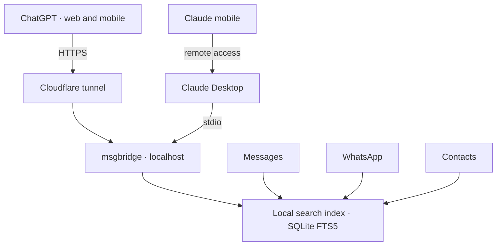

# msgbridge

**Ask ChatGPT or Claude about your messages—without copying and pasting a thread.**

msgbridge is a read-only MCP connector for your iMessage, SMS, and WhatsApp history on a Mac. It lets an assistant find conversations, retrieve relevant messages, and help you catch up, recall decisions, or draft a reply using your past messages as a style reference.

It works with ChatGPT on web and mobile, Claude Desktop, and Claude on your phone through Claude Desktop's remote access. Your Mac hosts the connector and local search index; retrieved messages are sent to the assistant you use.

> **You:** Who haven't I replied to this week?
>
> **ChatGPT:** Three conversations are waiting on you:
> - **Maya · iMessage · 4 days ago:** “did you ever book the cabin?”
> - **Alex · WhatsApp · 2 days ago:** “send me that recipe when you can”
> - **Bali trip group · yesterday:** a poll on flight dates
>
> **You:** Help me reply to Maya.
>
> **ChatGPT:** I read your last 40 messages with Maya, from October 2–29. Here's a draft in your usual style:
> “omg I totally forgot 😅 booking it tonight, does the 14th still work?”

*Illustrative interaction with fictional names and messages.*

## Why I built it

I use ChatGPT to think through conversations and stay organized: interpreting a message, drafting a reply in text or Gmail, or turning plans into calendar events and reminders. Sometimes the same conversation spans text and email, and the assistant needs both to understand what’s happening. Getting that context in was the painful part.

- **Copying long threads is fiddly.** Photos and link previews break selections, and longer conversations take several rounds.
- **Pasted context goes stale.** Every new message means another copy and paste.
- **A few screenshots leave gaps.** The assistant can miss earlier plans, your usual tone, or the conversation that led up to a message.

I wanted to ask a question and let the assistant retrieve the context it needed.

## What it does

- **Find conversations by name.** Search for a person, nickname, or group name without looking up phone numbers. Ambiguous matches let the assistant ask which person you mean.
- **Search across messaging apps.** Contacts matching connects a person's iMessage, SMS, and WhatsApp identities.
- **Keep the index current.** New messages are picked up within seconds while your Mac is awake and the connector is running.
- **Make retrieval visible.** Message-reading responses include source information: what was read, its date range, and whether older history exists.
- **Help draft replies in your voice.** The assistant can retrieve samples of your outgoing messages to reference your length, punctuation, and emoji use.
- **Measure messaging patterns.** Tools calculate message counts, initiation patterns, and reply-time statistics. These give the assistant evidence for discussing changes over time; they do not establish what someone feels or intends.
- **Surface conversations to revisit.** Find threads where the latest message is waiting on you.

## How it works

msgbridge reads the Messages, WhatsApp, and Contacts databases on your Mac and normalizes them into a local SQLite FTS5 search index. It exposes that index through eight read-only tools using the Model Context Protocol (MCP).



| Tool | Purpose |
| --- | --- |
| `find_conversations` | Find a person or group thread by name or nickname |
| `get_messages` | Page through a thread; reads over 500 messages require approval |
| `search_messages` | Search message text, optionally scoped to a thread or person |
| `get_message_context` | Retrieve messages surrounding a search result |
| `get_relationship_stats` | Calculate counts, initiation patterns, and reply-time statistics |
| `get_style_examples` | Retrieve examples of your outgoing messages for drafting |
| `list_unreplied` | Find conversations waiting on you |
| `get_status` | Report index coverage and freshness |

**Stack:** Python 3.12+, the official MCP SDK, SQLite FTS5, rapidfuzz, and phonenumbers.

## Engineering decisions

### Recovering message text from Apple's storage format

On recent macOS versions, message text is often stored in `attributedBody` rather than the database's `text` column. msgbridge decodes that serialized Objective-C representation so those messages can be indexed and searched.

### Reading recent messages without writing to the source

Recent messages can live in SQLite's write-ahead log (WAL). Opening `chat.db` with `immutable=1` skips that log and can silently miss the newest messages. msgbridge uses SQLite read-only mode instead, allowing it to read committed WAL content without modifying the message database.

### Resolving one person across multiple identities

A friend can appear under a phone number, an email address, a WhatsApp ID, or a privacy-preserving WhatsApp LID. msgbridge normalizes phone numbers to E.164 and uses Contacts matching to connect identities across apps. Name matching also needs to preserve ambiguity: two people named Stephen should remain distinct candidates.

### Giving macOS permissions a dedicated entry point

Messages access requires Full Disk Access. A small signed C launcher provides a dedicated entry point for msgbridge, rather than granting that permission to a general-purpose Python executable.

### Making the assistant's evidence inspectable

Instructions alone cannot guarantee that an assistant will cite its sources. Message-reading responses therefore begin with a source header describing the retrieved messages, date range, and available older history. Tool instructions ask the assistant to carry that context into its answer so users can assess how much evidence it used.

## Privacy and access

Message history is personal, so controlling access was a core design constraint.

- **Read-only access.** Source databases are opened in SQLite read-only mode. There is no tool for sending messages.
- **Local storage, selective retrieval.** The search index lives on your Mac. Messages retrieved through the tools are sent to ChatGPT or Claude and are subject to the service's data handling policies.
- **Authenticated remote access.** For ChatGPT, the server binds to localhost behind a Cloudflare tunnel. Remote access uses OAuth 2.1 with a single account authenticated by password and authenticator code.
- **Redaction before indexing.** Redaction targets one-time codes, card numbers, and Social Security numbers. It should not be treated as a guarantee that all sensitive information will be detected.
- **Untrusted message content.** Tool instructions tell the assistant to treat messages as data rather than instructions. This is a mitigation for prompt injection, not a guarantee of model behavior.

## Setup

### Requirements

- A Mac signed into Messages
- WhatsApp for Mac, if you want to index WhatsApp messages
- Python 3.12+ and `uv`
- Claude Desktop for Claude (desktop and mobile), or a hostname and Cloudflare tunnel for ChatGPT

### Build and index

From the repository directory:

```bash
uv sync
launcher/build.sh
```

In **System Settings → Privacy & Security → Full Disk Access**, add `bin/msgbridge-launch`. After rebuilding the launcher, turn its permission switch off and on again.

Build the index:

```bash
bin/msgbridge-launch index
```

### Claude Desktop

Add this entry to `claude_desktop_config.json`, replacing the path with your checkout location:

```json
{
  "mcpServers": {
    "msgbridge": {
      "command": "/path/to/msgbridge/bin/msgbridge-launch"
    }
  }
}
```

Quit Claude Desktop fully with **Cmd+Q**, then reopen it.

Claude on your phone can use msgbridge through Claude Desktop's remote access, as long as your Mac is awake and Claude Desktop is open. Adding the ChatGPT endpoint below to claude.ai as a custom connector should also work, but hasn't been tested.

### ChatGPT

ChatGPT connects to a public HTTPS endpoint backed by the server running on your Mac.

1. Create a named Cloudflare tunnel called `msgbridge`. Configure your hostname to route to `http://127.0.0.1:8765`, with the tunnel configuration in `~/.cloudflared/msgbridge.yml`.
2. Set the public address using `MSGBRIDGE_PUBLIC_URL`, or write it to the configuration file:

   ```bash
   echo https://msg.example.com > ~/Library/Application\ Support/MsgBridge/public_url
   ```

3. Set up authentication in your own terminal:

   ```bash
   bin/msgbridge-launch auth setup
   ```

4. Install the server and tunnel as login services:

   ```bash
   launcher/services.sh install
   ```

5. In ChatGPT, add a custom connector with the URL `https://msg.example.com/mcp` and sign in.

To revoke all app sessions:

```bash
bin/msgbridge-launch auth revoke-all
```

### Other commands

```bash
# Pick up new messages
bin/msgbridge-launch sync

# Check index coverage and freshness
bin/msgbridge-launch status

# Call a tool directly
bin/msgbridge-launch call find_conversations '{"query": "Maya"}'
```

## Development

```bash
uv run pytest
```

Tests use hand-built Messages and WhatsApp databases in `tests/fixture.py` and `tests/wa_fixture.py`, rather than real message history.

## Status and next steps

**Working today:** iMessage/SMS, WhatsApp for Mac, ChatGPT on web and mobile, Claude Desktop, and Claude mobile through Claude Desktop.

**Planned:**

- Import older WhatsApp history from an iPhone backup
- Add a per-person exclude list
- Add an audit log of what the assistant read

Availability and freshness depend on the history accessible on your Mac and the connector being available when the assistant requests it.
